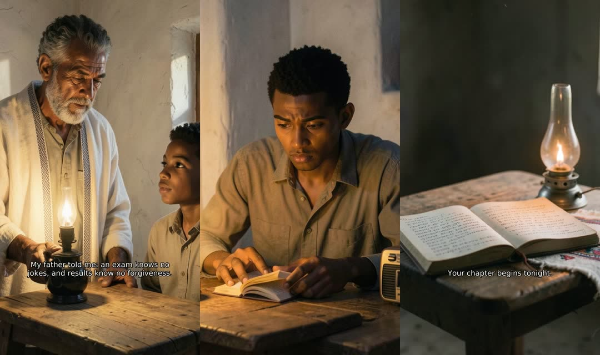
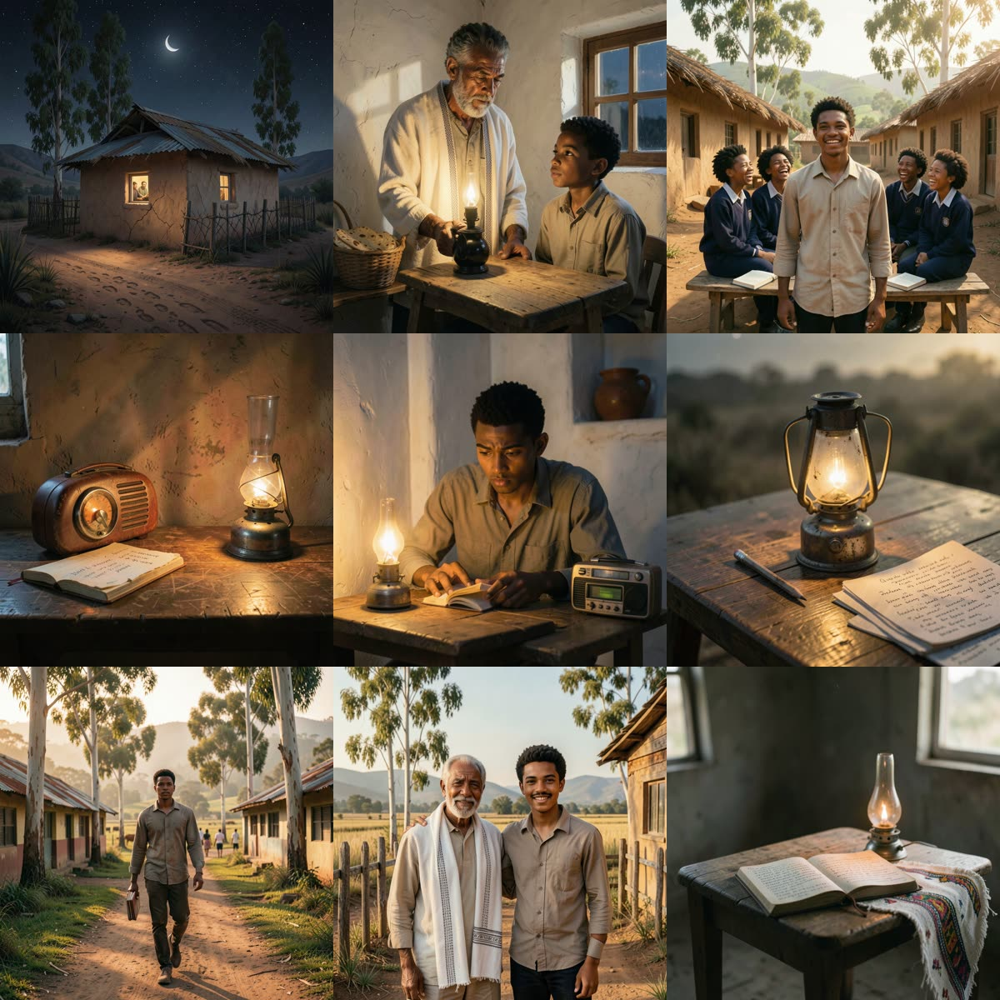
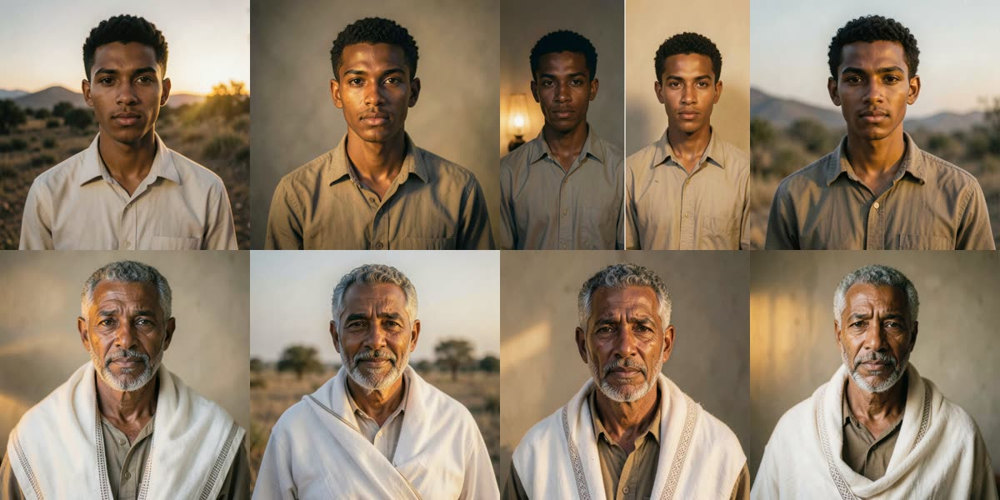
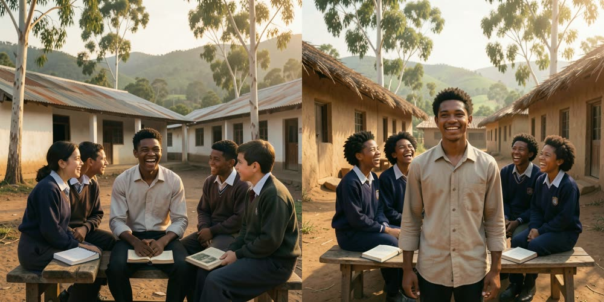
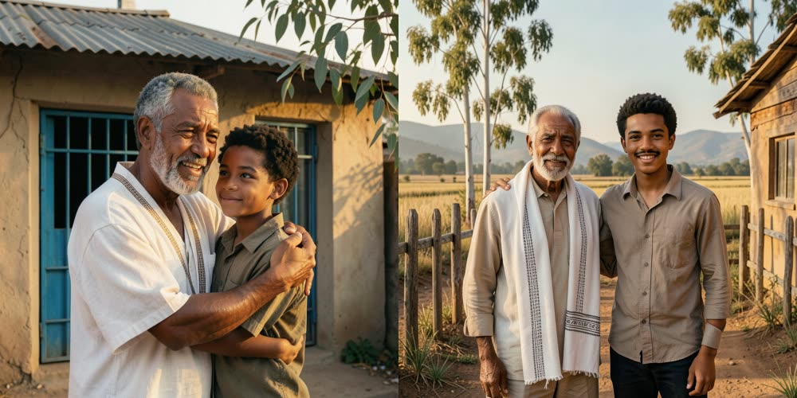

# Report: የመጨረሻው ምዕራፍ (The Final Chapter)

**B2W0: AI-Content Generation, Codebase and Report** · Dagmawi Teferi · 26 November 2026

- **Repository:** https://github.com/dagiteferi/AI-Content-Generations
- **Run it:** `make install` then `uv run heritage run` (the README gives each step)
- **Film:** 72.5 s, Amharic narration with English subtitles, exported as 9:16 and 16:9

---

## Executive summary

This report describes *The Final Chapter* (የመጨረሻው ምዕራፍ), a 72.5-second Amharic short film built around two sayings my father told me before my Grade 12 national exam. It is made for Ethiopian Grade 12 and exit-exam students, who watch on their phones. I built the film with a Python pipeline I wrote with a coding agent: one validated storyboard drives narration (Gemini TTS), keyframes (FLUX.2 klein), motion (Wan 2.2), music (ACE-Step 1.5) and the final FFmpeg edit, in both 9:16 and 16:9.

The pipeline caches every output by a content hash and logs every model call. The whole film cost about $0.22 at list price, and nothing on the free tiers. The hardest problem was making the people and places look Ethiopian; describing visible features, not nationalities or relationships, solved it. The least reliable part was free infrastructure: Gemini's main TTS model was down for hours, and Kaggle notebooks never got internet access. Fallbacks in the design meant the film was still finished.

## 1. What I set out to make, and for whom

The night before my Grade 12 national exam, my father told me two things:

> **ፈተና ቀልድ አያውቅም፤ ውጤትም ይቅርታ የለውም።**  
> *An exam knows no jokes, and results know no forgiveness.*
>
> **የመጨረሻው ምዕራፍ ቀልድ አይወድም።**  
> *The final chapter does not like jokes.*

I made a 72-second film around those two sayings. A student from the Ethiopian countryside laughs the year away. His father warns him one night. Something changes: the radio goes quiet, the lamp comes on, the pencil gets shorter. He walks calmly to the exam, and his father says the second saying on results day. The last line speaks to the viewer: **የእናንተ ምዕራፍ ዛሬ ማታ ይጀምራል** (*your chapter begins tonight*).

**Audience.** The film is for the people who follow my channel: Ethiopian Grade 12 students and final-year university students facing the exit exam (about 17 to 24 years old), and their parents. They watch on a phone, on TikTok, YouTube Shorts and Telegram, scrolling fast and often with the sound off at first.

**What I wanted them to feel.** A quiet seriousness, then hope, ending on the thought "my final chapter has started; tonight I open the book". It should push them to start, not frighten them.

**How the brief shaped the film:**

- **Vertical (9:16) first**, with subjects in the centre so the 16:9 version works from the same images.
- **Subtitles always on**, at most two lines, because many viewers start muted.
- **The first saying comes early** (shot 2), so the hook lands within the first seconds.
- **No failure scene.** The audience is anxious already.
- **Time passing is shown, not written.** The pencil grows shorter instead of a calendar appearing, because image models garble text.


*Figure 1. Frames from `film_9x16.mp4`: the first saying (s02), the late-night study (s05) and the closing line (s09). Subtitles sit inside the safe area for TikTok and Shorts.*

## 2. The pipeline

One storyboard file (`storyboard.json`, validated by a pydantic schema) drives every stage:

```
story.md ─draft─▶ storyboard.json ─┬─▶ narration (Gemini TTS) ─▶ radio cut ─▶ user test 1
                                    ├─▶ reference faces ─▶ keyframes (FLUX.2 klein)
                                    ├─▶ shots (Wan 2.2 on Kaggle, or Ken Burns fallback)
                                    ├─▶ music (ACE-Step 1.5 on Kaggle, 3 candidates)
                                    └─▶ assemble (FFmpeg) ─▶ film_9x16.mp4 + film_16x9.mp4
```

Design choices I'd defend:

- **A CLI, not a web app.** The brief asks for one command from a clean clone. `heritage run` runs everything, and `--stage`, `--shot`, `--dry-run` and `--force` let me rerun only what I need.
- **Content-hash caching.** Each output is named by a hash of everything that affects it (prompt, seed, model, parameters, input files). When I changed one narration line, only that line was regenerated. This mattered when the TTS service kept failing: lines that had already succeeded were never lost.
- **One log line per model call** in `runs.jsonl`: provider, model, seed, latency, cache hit, cost and error. `heritage report costs` turns it into the table in `COSTS.md`.
- **A fallback for every shot.** If a Wan clip is missing, the shot becomes a slow Ken Burns move over its keyframe. There is always a complete film, whatever the GPU quota.
- **FFmpeg as a Python package** (`imageio-ffmpeg`), so `make install` installs everything and nobody needs to install system software.


*Figure 2. The nine keyframes (s01–s09), generated with FLUX.2 klein from `storyboard.json`. Each shot has one purpose, and four of them are silent.*

## 3. What I learned from my audience

> **TODO (my own words):** fill this in from the user tests in `DESIGN.md` sections 5 and 6.

- **User test 1 (radio cut, voice and subtitles only):** I sent `radio.mp4` to three people from my audience: _roles, e.g. Grade 12 student, exit-exam student, parent_.
  - They said: _…_
  - What I changed because of it: _…_
- **User test 2 (near-final film):** _…_
  - What I changed because of it: _…_

Before any outside tests, I was my own first viewer. The first cut narrated every shot ("the pencil grew shorter") and felt like a lecture. I cut the narration from nine lines (82 words) to six short lines and made the other shots silent, so the images and the score carry the story (EXPERIMENTS E06). I also moved the story from Addis Ababa to the countryside so it matches where many of my viewers grew up.

## 4. The hardest problem, and how I solved it

**Making the people and places look Ethiopian, and keeping the son an adult.**

The first images looked South Asian, not Ethiopian, and the "Ethiopian home" looked like anywhere. I treated this as an experiment, changing one thing at a time with a fixed seed (EXPERIMENTS E03 to E05):

- **"Ethiopian" alone is not enough.** Describing the features worked: *"Habesha, East African features, deep brown skin, short tightly coiled black hair"*. Adding more words made it worse (a deformed hand appeared), so I stopped at the version that worked.
- **Places need concrete objects**, not a nationality: a jebena coffee pot, a mesob basket, a kerosene lamp, eucalyptus trees, corrugated iron roofs, a white gabi with a woven border.


*Figure 3. Reference portraits with the final descriptions (student seeds 11–14, father seeds 21–24): clearly Habesha, with the father's white gabi and woven border.*


*Figure 4. s03 before and after. Left: "laughing with classmates" gave European and Asian classmates. Right: describing the classmates as "Habesha Ethiopian teenagers with deep brown skin" fixed it.*

- **The word "son" made the model draw a 12-year-old**, even with "18 years old" in the prompt. Describing what the viewer sees instead (*"an older man and a tall young man of about 20 with a light moustache"*) fixed it on two of three seeds.


*Figure 5. s08 before and after. Left: "his 18-year-old son" still produced a child. Right: "a tall young man of about 20 with a light moustache", seed 1038.*

- **The safety filter flagged a father hugging his son** on one seed. Standing side by side with a hand on the shoulder passed, and shows their heights better.

**The lesson:** describe what is visible, not who people are or what they are called.

**A close second: unreliable free services.** Gemini's main TTS model (`gemini-3.8-flash-tts`) hung for hours. I added a hard 120-second deadline and network-error retries so the run fails cleanly instead of freezing (FAILURES F06, F08). Then I switched to `gemini-3.1-flash-tts-preview`. It doesn't accept a style instruction and returns raw PCM audio instead of WAV, so I made both of those work in code (F10). Thanks to the cache, nothing already generated was lost.

## 5. A suggested practice that helped, and one that did not

**Helped: "time the narration first", via the radio cut.** I generated the voice before any pictures and built a radio cut (voice and subtitles on black). Its timing table showed three shots where the voice ran longer than the shot. I fixed the durations before generating a single keyframe (E02), so no image or clip was made at the wrong length. It also gave me something cheap to test with my audience early.

**Did not help: relying on Kaggle for the GPU stages.** I automated the hand-off completely: `heritage gpu push shots` uploads the jobs and starts a T4 notebook, and `heritage gpu pull` imports the results. But Kaggle notebooks had no internet, even with internet enabled in the metadata and after I verified my phone, so neither diffusers nor ACE-Step could install (F09). A probe notebook failed for seven hours. The Ken Burns fallback meant the film was still complete, but if I did this again I would test GPU access on day one with a five-line notebook, and keep a second GPU option (Colab) ready.

## 6. Ceiling work

- **One-command GPU round trip** (`heritage gpu push` / `heritage gpu pull`): uploads a dataset, starts a GPU kernel with the right setup, then downloads, checks and imports the results, with each job logged.
- **Two formats from one source.** Square keyframes and clips are cropped to 9:16 and 16:9, with subtitles placed inside each format's safe area.
- **A professional audio mix.** The music ducks under the voice (sidechain compression), and two-pass loudness normalisation brings the film to −14 LUFS, the level TikTok and YouTube expect.
- **Silent shots in the contract** (`narration: null`), so "show, don't tell" is a data decision, not a code change.
- **A cost report** built from `runs.jsonl` (`heritage report costs --write`). The whole film cost about **$0.22 at list price**, and $0 in practice on the free tiers (see `COSTS.md`).
- **47 automated tests**, including cache keys, timeline planning, silent shots and the TTS deadline.

## 7. What I would build next

1. **A better Amharic voice.** Gemini's Amharic is understandable but sometimes flat. Next I'd try another TTS model, or record a human narrator, with the pipeline swapping the provider.
2. **Character consistency from the approved reference.** FLUX.2 klein accepts reference images. Conditioning every keyframe on the approved face would keep the student the same person across shots.
3. **A small storyboard editor**, so a non-developer (a teacher, or my channel's audience) can change a line or a shot and rerender only that part.
4. **A second GPU backend** (Colab or a paid hourly GPU), selected automatically when Kaggle fails.

## 8. Ethics and disclosure

- The characters are fictional and inspired by my family. No real face or voice is used, and the narrator is an AI voice, not my father's.
- The end card says *"Made with AI (Gemini, FLUX.2, Wan 2.2, ACE-Step). Words from my father."* I switch on the AI-content label when posting.
- Licences, data choices and limits are in `ETHICS.md` and `COSTS.md`.
